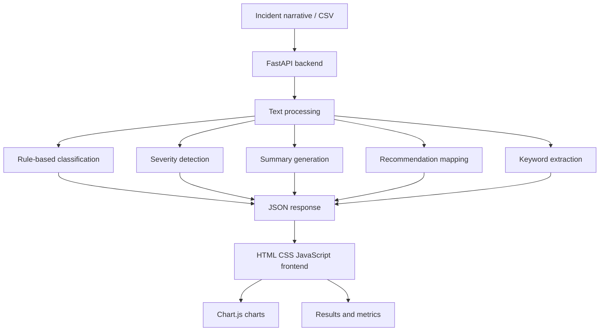
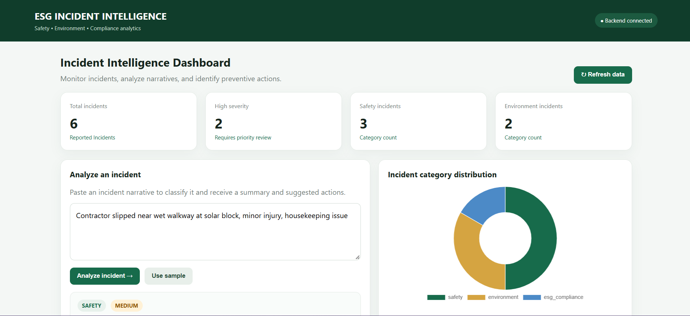
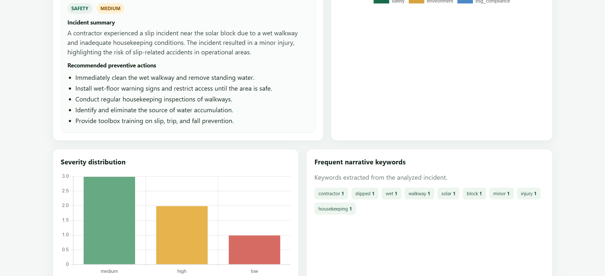
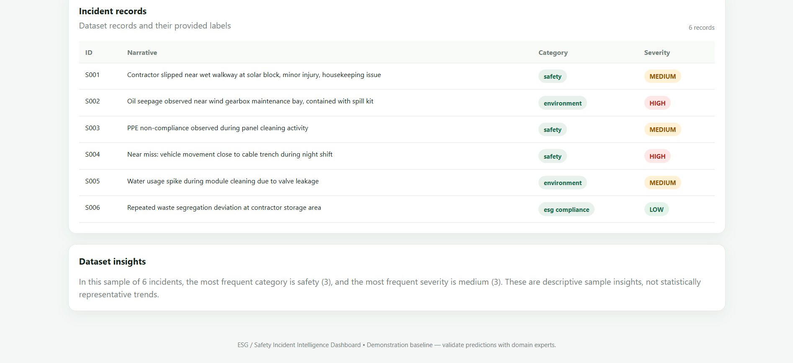

# ESG Safety Incident Intelligence Dashboard

A web-based incident intelligence dashboard that analyzes workplace safety, environmental, and ESG compliance incident descriptions using rule-based processing. It categorizes incidents, identifies severity, generates summaries and recommendations, extracts keywords, and presents results through interactive visualizations.

**Live Application:** https://esg-safety-incident-intelligence-dashboard-production-38fd84ea.up.railway.app/  
**API Documentation:** https://esg-safety-incident-intelligence-dashboard-production-38fd84ea.up.railway.app/docs

## Table of Contents
- [Project Overview](#project-overview)
- [Problem Statement](#problem-statement)
- [Objectives](#objectives)
- [Key Features](#key-features)
- [Technology Stack](#technology-stack)
- [System Architecture](#system-architecture)
- [Project Workflow](#project-workflow)
- [Dataset](#dataset)
- [Classification and Severity Detection](#classification-and-severity-detection)
- [Evaluation](#evaluation)
- [API Documentation](#api-documentation)
- [Project Structure](#project-structure)
- [Installation and Setup](#installation-and-setup)
- [Running the Application](#running-the-application)
- [Sample Input](#sample-input)
- [Screenshots](#screenshots)
- [Limitations](#limitations)
- [Future Enhancements](#future-enhancements)
- [Deployment](#deployment)
- [Author](#author)

## Project Overview
The dashboard provides a centralized interface for reviewing incident records and understanding their categories, severity levels, and recommendations. The current implementation uses **rule-based logic** and is a demonstration/decision-support prototype—not a replacement for professional safety assessment.

## Problem Statement
Organizations record workplace safety, environmental, and ESG compliance incidents in textual reports. Reviewing them manually can make it difficult to identify categories, prioritize serious cases, and recognize recurring risks. This project processes incident descriptions and displays categorized, severity-based results in one dashboard.

## Objectives
- Analyze incident descriptions.
- Categorize incidents into ESG incident categories.
- Identify severity using predefined rules.
- Generate summaries and recommendations.
- Extract relevant keywords.
- Display metrics and incident records.
- Provide API endpoints for analysis and dashboard data.

## Key Features
- Incident narrative analysis.
- Keyword-based classification.
- Rule-based severity detection.
- Template-based summaries and mapped recommendations.
- Keyword extraction.
- KPI metrics, charts, and incident table.
- Evaluation endpoint for predicted categories vs reference labels.
- FastAPI REST endpoints.
- Railway deployment.

## Technology Stack
| Component | Technology |
|---|---|
| Backend | Python, FastAPI |
| Data processing | pandas |
| Evaluation | Scikit-learn |
| Frontend | HTML, CSS, JavaScript |
| Charts | Chart.js |
| Dataset | CSV |
| API | JSON / REST |
| Deployment | Railway |
| Version control | Git, GitHub |

## System Architecture


## Project Workflow
1. Load records from CSV or submit an incident narrative.
2. Normalize the incident text.
3. Match words against predefined rules.
4. Determine category and severity.
5. Generate a summary and recommendations using rule-based logic.
6. Extract keywords.
7. Return results through FastAPI.
8. Display results, metrics, and visualizations in the dashboard.
9. Compare predicted categories with reference labels through evaluation.

## Dataset
**File:** `data/safety_esg_incidents.csv`

The demonstration dataset contains six sample records.

| Column | Description |
|---|---|
| `incident_id` | Unique incident identifier |
| `narrative` | Text description |
| `target_category` | Reference category |
| `target_severity` | Reference severity |

The dataset demonstrates incident processing and comparison with reference labels. It is small and does not establish real-world generalization.

## Classification and Severity Detection
### Classification
Predefined keyword dictionaries identify categories such as Safety, Environment, and ESG Compliance. Category selection is based on matching terms in the narrative.

### Severity
Predefined risk keywords and conditions assign levels such as High, Medium, and Low. This is rule-based logic, not a trained ML model.

### Summaries and Recommendations
Summaries use predefined templates and fallback logic. Recommendations are selected through rule-based mappings.

## Evaluation
**Endpoint:** `/api/evaluation`

The endpoint compares predicted categories from the rule-based logic with reference categories in the sample dataset and calculates accuracy using Scikit-learn.

**Limitations:** only six sample records; no train/test split; evaluation measures a rule-based baseline, not a trained model; results do not establish performance on unseen incidents. A larger labeled dataset and proper validation are needed.

## API Documentation
The backend uses FastAPI.

| Method | Endpoint | Description |
|---|---|---|
| GET | `/` | Serves dashboard frontend |
| GET | `/api/demo` | Provides demo/sample data |
| POST | `/api/run` | Analyzes a submitted incident |
| GET | `/api/incidents` | Returns incident records |
| GET | `/api/metrics` | Returns dashboard metrics |
| GET | `/api/trends` | Returns keyword trends |
| GET | `/api/evaluation` | Returns rule-based evaluation |
| GET | `/docs` | Swagger API documentation |

### Sample Input
```json
{
  "narrative": "Contractor slipped near wet walkway at solar block, minor injury."
}
```
Inspect `/docs` for the exact request schema and response fields.

## Project Structure
```text
ESG-Safety-Incident-Intelligence-Dashboard/
├── backend/
│   ├── __init__.py
│   └── app.py
├── data/
│   └── safety_esg_incidents.csv
├── frontend/
│   └── index.html
├── requirements.txt
├── Procfile
├── README.md
└── .gitignore
```

## Installation and Setup
### Prerequisites
- Python 3.10 or compatible
- Git
- VS Code or another editor

### 1. Clone
```bash
git clone https://github.com/NikhilChapala22/ESG-Safety-Incident-Intelligence-Dashboard.git
cd ESG-Safety-Incident-Intelligence-Dashboard
```

### 2. Create a virtual environment
**Windows PowerShell**
```powershell
python -m venv venv
venv\Scripts\activate
```
**Linux/macOS**
```bash
python3 -m venv venv
source venv/bin/activate
```

### 3. Install dependencies
```bash
pip install -r requirements.txt
```

## Running the Application
From the repository root:
```bash
uvicorn backend.app:app --reload
```
- Dashboard: http://127.0.0.1:8000/
- API docs: http://127.0.0.1:8000/docs

## Sample Input
```text
Contractor slipped near wet walkway at solar block, minor injury.
```
The system processes the narrative and returns incident category, severity, summary, recommendations, and keywords according to the rules configured in `backend/app.py`.

## Dashboard Screenshots

### Dashboard Overview


### Incident Analysis and Severity Distribution


### Incident Records and Dataset Insights



## Limitations
- Only six sample incidents are included.
- Classification and severity depend on predefined keywords.
- Summaries and recommendations use rules/templates.
- Unfamiliar or ambiguous wording may cause incorrect results.
- Evaluation is limited to the supplied dataset.
- No trained ML model, LLM, RAG pipeline, or AI agent is currently integrated.
- The prototype must not replace professional incident investigation or safety decisions.

## Future Enhancements
- Use a larger, representative labeled dataset.
- Train and validate an ML classification model.
- Improve contextual severity detection.
- Evaluate using precision, recall, and F1-score.
- Integrate an LLM for evidence-grounded explanations.
- Explore RAG over verified safety policies and ESG documents.
- Add authentication, role-based access, and persistent storage.
- Improve reporting, filtering, export, testing, and monitoring.

## Deployment
Deployed on Railway:
- **Dashboard:** https://esg-safety-incident-intelligence-dashboard-production-38fd84ea.up.railway.app/
- **API docs:** https://esg-safety-incident-intelligence-dashboard-production-38fd84ea.up.railway.app/docs

The `Procfile` starts the FastAPI application.

## Author
**Chapala Nikhil**
- GitHub: [NikhilChapala22](https://github.com/NikhilChapala22)
- Repository: [ESG Safety Incident Intelligence Dashboard](https://github.com/NikhilChapala22/ESG-Safety-Incident-Intelligence-Dashboard)

---
*Demonstration project for rule-based incident analysis, API development, data processing, and dashboard visualization.*
